<div align="center">


### Building intelligent systems that are practical, reliable, and production-ready.

<a href="https://github.com/Aditya-k63"></a>
<a href="https://www.linkedin.com/in/aditya-kumar1407"></a>
<a href="mailto:adityakumar14072003@gmail.com"></a>

<br/><br/>


</div>

---

## About

I am a **B.Tech student specializing in AI & ML** who enjoys taking ideas from a model or algorithm and turning them into complete software systems.

My work sits at the intersection of **Generative AI, Retrieval-Augmented Generation, machine learning, backend engineering, and data-driven applications**. I focus on systems that are structured for evaluation, deployment, observability, and reliability.

### What I work on

- **Generative AI & RAG** — hybrid retrieval, GraphRAG, embeddings, reranking, evaluation, and LLM applications
- **AI Agents** — LangGraph workflows, tool calling, planning, memory, routing, and human-in-the-loop execution
- **ML Engineering** — NLP, forecasting, classification, feature engineering, model evaluation, and deployment
- **Backend Engineering** — FastAPI, REST APIs, PostgreSQL, Neo4j, authentication, caching, and service design
- **MLOps & DevOps** — Docker, CI/CD, reproducible benchmarks, monitoring, and production-oriented workflows

---

## Current Focus

<div align="center">

| Focus Area | What I am building |
|:---:|:---|
| **RAG Systems** | Hybrid vector + BM25 + graph retrieval with reranking and evaluation |
| **Agentic AI** | Stateful workflows with planning, tools, routing, and review loops |
| **AI Engineering** | FastAPI services around ML and LLM systems |
| **System Reliability** | Fallbacks, retries, caching, evaluation, and deterministic CI |

</div>

---

## Tech Stack

<div align="center">

### Languages


### AI / ML


### Backend & Data


### Tools & Infrastructure


### AI Ecosystem


</div>

---

## Selected Projects

### 01 · Enterprise Hybrid GraphRAG
**Hybrid vector + BM25 + graph retrieval with a corrective fallback layer.**

`PDF → Parsing → Semantic Chunking → Embeddings → PostgreSQL/pgvector + Neo4j → Query Classification → Vector/BM25/Graph Retrieval → RRF → Cross-Encoder Reranking → LLM Generation`

- Hybrid pgvector + BM25 + Neo4j graph retrieval, fused with Reciprocal Rank Fusion and cross-encoder reranking
- Intent-based query classifier routes each question to vector, graph, or hybrid retrieval
- **Corrective RAG (v4):** a grader agent checks whether the retrieved context actually answers the question, and falls back to live web search instead of guessing
- Measured on a golden set — faithfulness **0.9633**, answer relevance **0.4962 → 0.6967** with CRAG, and **0.0440 → 0.6938** on out-of-knowledge-base questions
- Authentication, rate limiting, query caching, session memory, analytics, and evaluation endpoints
- Dockerized services with GitHub Actions CI/CD that runs the benchmark offline (`ENABLE_LIVE_LLM=false`) so results stay reproducible

→ **Repository:** [Hybrid-GraphRAG-System](https://github.com/Aditya-k63/Hybrid-GraphRAG-System) · **Live:** [enterprise-hybrid-graphrag.onrender.com](https://enterprise-hybrid-graphrag.onrender.com/)

### 02 · Multilingual Indic NER
**IndicBERTv2 fine-tuned for Hindi NER, with zero-shot transfer to three more languages.**

- Fine-tuned on 100k silver-labeled Hindi Naamapadam sentences; **82.74% entity-level F1** on the official gold test set (+8.7 over a BiLSTM-CRF baseline)
- Zero-shot cross-lingual transfer with no target-language training — Bengali **80.82%**, Tamil **75.06%**, Telugu **85.31%** F1
- Bootstrap 95% confidence intervals and error analysis (boundary errors dominate on long 5+ token organization names)
- FastAPI inference service with an interactive entity-highlighting UI, CPU-optimized Docker image, published to Docker Hub

→ **Repository:** [multilingual-indic-ner](https://github.com/Aditya-k63/multilingual-indic-ner) · **Model:** [Hugging Face](https://huggingface.co/neuronsbyisshu/indicbert-hi-ner-naamapadam)

### 03 · GridCast — Energy Demand Forecasting
**24-hour-ahead household electricity forecasting with calibrated uncertainty.**

- LightGBM on 167M smart-meter readings from 4,443 London households, aggregated into a single hourly demand series (19,864 hours, zero gaps)
- **0.0109 MAE** — 55.1% below a seasonal-naive baseline (Holt-Winters rejected at +113.3%)
- Split-conformal calibration lifted interval coverage from **64.3% → 82.6%** at a nominal 80%, calibrated on validation residuals only
- Error analysis isolated holidays as the dominant failure mode; a controlled holiday-as-Sunday encoding cut holiday MAE **20.6%**
- FastAPI recursive-inference service with a test-period replay UI, Docker + GitHub Actions CI/CD, models published to Hugging Face Hub

→ **Repository:** [energy-demand-forecasting](https://github.com/Aditya-k63/energy-demand-forecasting) · **Model:** [Hugging Face](https://huggingface.co/neuronsbyisshu/london-energy-demand-forecast-lgbm)

### 04 · ExperimentLens — A/B Testing & Experimentation Analytics
**An experimentation framework where a p-value below 0.05 is never sufficient to ship.**

- Two-proportion z-test, chi-square goodness-of-fit for sample-ratio mismatch, and simulation-based Type I error calibration on 294,478 rows
- Bayesian posterior on the same 2×2 table — 94% HDI, `P(B > A)`, and expected revenue impact — with the README stating plainly that these summaries are *not* independent confirmations
- Verdict **DON'T SHIP**: the credible interval excludes the +1% worthwhile-lift range, `P(B > A) = 0.1197`, and expected revenue is **−5,188**
- Minimum detectable effect of **+2.53%** surfaced as a design warning — the experiment was underpowered for the question it was run to answer
- Decision engine with deliberately asymmetric gates: SHIP requires all 4 criteria, DON'T SHIP requires any 1 of 3

→ **Repository:** [ab-testing-experimentation](https://github.com/Aditya-k63/ab-testing-experimentation)

### 05 · Brain Tumor MRI Classifier
**EfficientNetB0 transfer learning with Grad-CAM explainability and a production FastAPI service.**

- 95% accuracy across 4 classes; glioma recall lifted from **65% → 83%** via dataset rebalancing plus decision-threshold optimization
- Custom glioma decision threshold, focal loss, and class weights after four iterations on the failure mode
- FastAPI backend with Grad-CAM overlays, batch prediction, confidence thresholds, and request tracing
- Resolved a Keras 2/3 serialization break by rebuilding the architecture in code and loading weights separately
- Docker + GitHub Actions CI/CD publishing to Docker Hub, model hosted on Hugging Face Hub

→ **Repository:** [brain_tumor](https://github.com/Aditya-k63/brain_tumor) · **Live:** [brain-tumor-xw48.onrender.com](https://brain-tumor-xw48.onrender.com/)

### 06 · Task Planner Agent
**LangGraph agent that turns a high-level goal into an executable task DAG.**

- Planning → execution → review → routing state machine with self-healing retries and dynamic provider fallback across Groq and OpenRouter
- Dependency-aware DAGs of up to 12 tasks, with a clarification flow instead of guessing when the goal is ambiguous
- Lazy-loaded tool registry with 8 tools — file operations, sandboxed shell, web search, and URL fetch
- Session state, human-in-the-loop input, FastAPI service, Docker + CI/CD

→ **Repository:** [Autonomous-Task-Planning-System](https://github.com/Aditya-k63/Autonomous-Task-Planning-System)

### More Projects
[CRAG — Corrective RAG](https://github.com/Aditya-k63/CRAG) · [STGCN Traffic Forecasting](https://github.com/Aditya-k63/stgcn-traffic-forecasting) · [Customer Churn API](https://github.com/Aditya-k63/churn-prediction-ml-api) · [Crypto Direction Predictor](https://github.com/Aditya-k63/crypto-direction-predictor) · [Heart Disease Prediction](https://github.com/Aditya-k63/Heart-Disease-Prediction) · [Ticket Categorizer](https://github.com/Aditya-k63/Ticket-Categorizer) · [MLOps Batch Job](https://github.com/Aditya-k63/mlops-task) · [RAG Assistant](https://github.com/Aditya-k63/Rag) · [DSA / LeetCode](https://github.com/Aditya-k63/dsa_repo)

---

## Open Source Contributions

I contribute to open-source projects by identifying concrete bugs, improving dataset metadata, adding regression coverage, and extending developer tooling.

### Microsoft MarkItDown — YAML Converter
**Pull Request #2472 · Open**

Added a YAML-to-Markdown converter supporting `.yaml` and `.yml` files, including nested mappings, lists, tables, multiple YAML documents, anchors/aliases, multiline strings, and edge cases. Added converter registration and comprehensive tests.

→ [View PR #2472](https://github.com/microsoft/markitdown/pull/2472)

### SignalFlow — FastAPI Route Fix
**Pull Request #14 · Merged**

Fixed a FastAPI route-ordering bug where `DELETE /api/executions/all` was being captured by the parameterized `DELETE /api/executions/{execution_id}` route. Added regression tests covering both bulk and single-execution deletion.

→ [View PR #14](https://github.com/scottcollier10/signalflow/pull/14)

### llmsectest — Secret Match Classification
**Pull Request #8 · Merged**

Improved secret-leak detection so exact-case and case-insensitive matches are distinguished, with regression tests for both behaviors.

→ [View PR #8](https://github.com/wehnsdaefflae/llmsectest/pull/8)

### Awesome Data — Dataset Metadata Maintenance

Contributed multiple fixes to `awesomedata/apd-core`, including:

- Updated the MIT Heart Rate Time Series dataset link to the PhysioNet archive. **PR #386 — merged**.
- Updated USDA Nutrient Database metadata to reflect FoodData Central. **PR #387 — merged**.
- Updated the CIMA histological microscopy dataset link to an accessible Kaggle mirror. **PR #388 — merged**.
- Fixed the Cell Image Library homepage URL and metadata. **PR #389 — merged**.

→ [View Awesome Data contributions](https://github.com/awesomedata/apd-core/pulls?q=is%3Apr+author%3AAditya-k63)

---

## Engineering Approach

```text
Problem → Data / Documents → Retrieval or ML Pipeline → Model / LLM
        → Evaluation → API / Product → Reliability → Deployment / CI/CD
```

**Retrieval quality · evaluation · latency · failure handling · security · reproducibility · deployment**

---

## AI / ML Areas

| Area | Technologies / Concepts |
|---|---|
| **Generative AI** | LLMs, prompt engineering, RAG, GraphRAG, tool calling |
| **Retrieval** | pgvector, BM25, graph retrieval, RRF, reranking |
| **Agents** | LangChain, LangGraph, stateful workflows, memory |
| **NLP** | TF-IDF, transformers, BERT, classification, semantic similarity |
| **Deep Learning** | PyTorch, TensorFlow, GNNs, STGCN, transfer learning |
| **Machine Learning** | XGBoost, Random Forest, Logistic Regression, SVM, clustering |
| **MLOps** | MLflow, Docker, GitHub Actions, evaluation pipelines |
| **Backend** | FastAPI, REST APIs, PostgreSQL, Neo4j, authentication |

---

## GitHub Activity

<div align="center">

<a href="https://github.com/Aditya-k63">
  
</a>
<a href="https://github.com/Aditya-k63">
  
</a>

<br/><br/>

### Contribution Activity


</div>

---

## Beyond Projects

- Data structures and algorithms
- SQL and data modeling
- System design for AI applications
- Prompt engineering and LLM evaluation
- Experimentation and model analysis
- Writing maintainable, testable Python

---

## Let's Connect

I am interested in opportunities and collaborations around **AI/ML engineering, Generative AI, RAG, intelligent agents, and backend systems**.

<div align="center">

<a href="https://www.linkedin.com/in/aditya-kumar1407">LinkedIn</a> •
<a href="https://github.com/Aditya-k63">GitHub</a> •
<a href="mailto:adityakumar14072003@gmail.com">Email</a>

<br/><br/>


</div>
